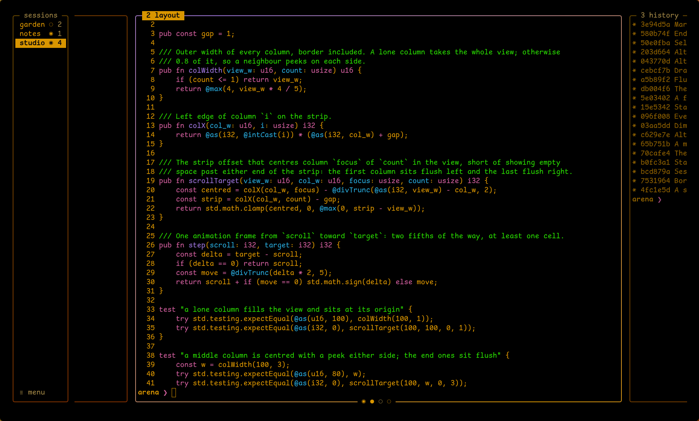
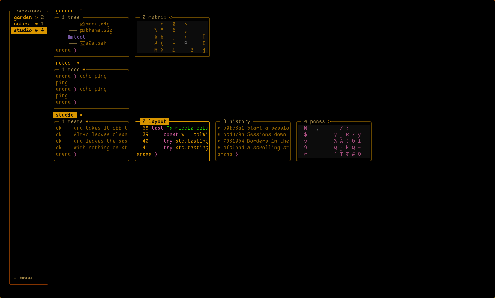

# arena

tmux sessions as a scrolling strip of columns, in your terminal.

Each tmux window is a column. The focused one sits in the middle and its neighbours peek in from
the sides, the way a scrolling window manager lays out a desktop. Sessions are stacked: left and
right move between windows, up and down between sessions.



arena is a tmux client, not a replacement for it. Your sessions live in the tmux server as they
always did; arena draws them and leaves them running when it quits.

## What it does

- **A strip per session.** Windows are columns with rounded borders; the focused one has a slowly
  turning gradient. The first and last columns sit flush against the edges.
- **Report this.** `Alt+!` (or Report this in the menu) asks one line, "what's wrong?", and files a
  babylon ticket in arena with it: what the pointer is over, what is picked, the view, the
  window's size and arena's commit. The screen as text (with the styles around
  the pointer) and the last input are saved beside it in `$XDG_STATE_HOME/arena/reports/`, so a
  bug arrives reproducible. What is typed into a pane is counted there, never kept.
- **Marks on windows running Claude Code**: `◐` turning while it works, or while a subagent it
  started works, `◔` between turns while only a shell it started runs, `◉` once it is done and
  until you look, `▲` while it waits on an answer; a session's mark has a count when several of
  its Claudes share it, `▲2`, and with no Claude to mark it has tmux's own `!` for a window that
  rang its bell or `#` for one with output where `monitor-activity` is on. One out of view that comes to wait or is done
  is a desktop notification too, through `notify-send` where there is one. arena's Claude Code plugin sets the pane option `@arena_claude` to
  `working`, `background`, `done`, `waiting` or `stalled` (its turn ended on an API error) ([Install](#install)).
- **Its Claudes listed** on the plan, in flight, and in the go-to list. A Claude has its mark, what its conversation is about
  and how long it has been in its state; under that what it is doing, waits for or last said,
  with how long its last turn took, or `quiet` and how long when it has worked ten minutes with
  nothing heard from it; under that its branch (or `no repo`, `detached` and the commit), its
  review and its context: the share of its budget, drawn to be seen past 80%, where your status
  line sets the pane option `@arena_claude_ctx` to it (hooks are not told the window's size),
  else its tokens; and under that a row for each subagent it has in the background, then its
  shells there. A subagent's row is lit while its Claude shows that subagent, where the Claude
  is in the session in view. What a conversation is about is the name you gave it with `/rename`, else a topic Haiku
  is asked for every fifth prompt (one small `claude -p` call, in the background), else the title
  Claude Code gave it at its start. The hook needs `jq` for all of that text.
- **A mark for code review** beside it: `✗` when changes are asked for, `»` while queued to merge,
  `✓` once approved, `◆` once landed. Set the pane option `@arena_review` to `changes`, `queued`,
  `reviewed` or `landed`; a session shows the one that most wants looking at.
- **Panes**, drawn where tmux has them. Click one to select it, drag the line between two to resize.
- **An overview** of every session's windows at once.
- **Home is the plan**, from [babylon](https://github.com/lessthanseventy/babylon)'s tickets, which every
  Claude on the machine shares: what is running, what comes next and why, how far each goal has
  got, and what landed. `arena` with no session named opens it, and `b` in normal mode, a click on
  `◆ home` in the foot row and `arena inbox` go there. The orchestrator's column is pinned on
  its right (60 cells, less on a narrow screen), and at half a screen home shows one of the two,
  `p` for the plan and `o` for the column.

  

  - **now** is each Claude at work, how long, and `stalled` when it has gone quiet; the pipeline
    (verifying, reviewing, landing) is under it. **next** is a short numbered list, each ticket with
    a why in a line and what it waits on (`free now`, `needs #589`); auto starts from its top. **goals**
    are the epics, a bar and a count each, the focal one atop. **landed** is today's, and
    **not planned** the todo cards that are in no next.
  - `j` `k` pick through the rows, `⏎` goes (to a Claude, or starts a ticket of next now), `space`
    opens the ticket and `t` its modal. On a row of next, `J` `K` move it, `x` takes it out, `e` edits
    its why, and dragging a row onto another takes that place. Every one runs `babylon next …`.
  - The column's head says the orchestrator's state (`working 12s`, `▲ waits on you`, `idle`,
    `◌ restarting`, `off`) and its context's share; while it is off it says
    `orchestrator off · ⏎ start it`, and Enter there runs `babylon orchestrator`. When the
    orchestrator's session ends, as babylon restarts it, home stays open in the session you were
    in, and the column comes back on the new one with the keys where you left them. Alt+l, or a click
    on it, focuses it, and what is typed, the wheel and the mouse are then its own. Alt+h, or a click
    on the plan, goes back. `` ` `` folds it away.
  - Atop the column is the feed: what is your move as babylon's `needs_you` words it, each with its
    actions, then what is landing in queue order, what is being built, and how many landed today. It
    is read from babylon's file, so it stays while the orchestrator is off or restarting. The plan's
    pick and the feed's light each other's ticket, dim.
  - On a ticket's row: `G` on a free ticket lists the running Claudes and gives it to one, `H` asks
    its Claude to hand it off, `e` edits it in `$EDITOR`, `p` raises its priority, `>` closes a
    ticket still to do and `<` opens it again, `w` puts it at the bottom of next and asks its why,
    `W` at the top, and `+` files a ticket. `/` finds by number or title and `r` narrows every
    window to one repo. `space` shows the whole ticket: its body, links, stage and the note on it,
    and the last of its gate's log.
  - `o` opens the orchestrator, started first when it is not running. While babylon's auto mode
    is on, babylon starts a Claude on each free ticket, from the top of next, up to its cap of
    Claudes working, and the head says `auto 1/2`. `A`, or a click on the head's `auto`,
    opens its settings: auto and hold as switches, and each repo's cap as `[-] 2 [+]`, 0 pausing
    it (`j` `k` pick, `+` `-` step, `a` `H` switch, `esc` closes). A change shows at once and
    babylon is told the last value; a click on the switch itself still turns auto on or off.
- **Jump** to any window in any session by typing part of its name.
- **A menu** for everything, for when you would rather click.
- **Mouse throughout**: click, wheel, drag to select and copy (shift-drag over a program that takes
  the mouse), middle click to paste what was last selected, drag a title to reorder.
- **Search** in a pane's history.




| | |
|---|---|
|  |  |

## Install

From a release: download the tarball for your machine (Linux or macOS, x86_64 or aarch64) from the
[releases](https://github.com/lessthanseventy/arena/releases), check it against its `.sha256`, and put
`arena` on your path. It needs tmux.

```sh
sha256sum -c arena-<version>-<target>.tar.gz.sha256   # shasum -a 256 -c on macOS
tar xzf arena-<version>-<target>.tar.gz
arena-<version>-<target>/arena --version
```

`mise run dist` builds the four tarballs into `dist/`.

From a checkout, arena needs tmux and [Zig](https://ziglang.org) 0.17.1. With [mise](https://mise.jdx.dev):

```sh
git clone https://github.com/lessthanseventy/arena
cd arena
mise install
mise run build
```

The binary is `zig-out/bin/arena`. Put it on your path however you like.

The marks on windows running Claude Code come from its hooks, which the checkout is a plugin of:
`claude --plugin-dir /path/to/arena`, or the path in `CLAUDE_CODE_PLUGIN_DIRS` (a `:` list) for
every session. babylon's own plugin gives each session its tickets, shared
by every Claude on the machine, over MCP, and its hooks; arena's plugin keeps only the marks and the tmux guard.

## Use

```sh
arena             # home: the plan and the orchestrator's column; with no board, the most recent session
arena work        # the session called work, made if it is not there
arena -L socket   # a tmux server other than the default one
arena plan 240    # the plan with its pick on ticket 240, in the arena that is running (`arena board 240` is the same)
arena show %290   # pane 290 in front: its session and window
arena show '#324' # the pane of the Claude holding ticket 324
arena inbox       # home, with what needs you atop the orchestrator's column
```

`plan`, `show` and `inbox` are the only supported way in from outside arena: the shell's popups,
babylon's notices and other Claudes all call them, so each place sends the human somewhere
through arena, which follows, not behind its back through tmux's `select-window`, which it
does not. With no arena running, `show` and `inbox` exit 3 and leave opening one to the caller.

`arena plan <id>` has the running arena open the plan with that
ticket picked and comes back at once. A ticket the plan shows in no window has its whole
detail over the plan in the pick's place. `arena board <id>` is the same, kept one more release.
With no arena running it starts one, so opened. It reaches arena through tmux, and only arena: each
arena names its client in the server's `@arena_clients`, so another control-mode client there,
as iTerm's, is told nothing. `-L` names the server there too.

There are two modes, and a single letter is never arena's in the first. In insert, the default,
every key goes to the shown pane, apart from a few Alt chords. `Ctrl+Space` makes it normal,
where no key is typed into a pane, `NORMAL` shows at the bottom-left and the row under the strip
says the keys; `i`, `Esc` or `Ctrl+Space` is insert again. A click on a pane is insert, and one
on the foot row is normal. With home open, `Ctrl+Space` focuses the orchestrator's column, as
`Alt+l`.

Alt+j, Alt+m, Alt+o, Alt+p and Alt+w are not arena's, so they reach Claude Code: Alt+o toggles
its fast mode and Alt+p opens its model picker. Their arena uses are the normal-mode keys below.

In normal mode:

| Key | Does |
|---|---|
| `j` `k` | the session below, above |
| `]` `[` | the next or previous Claude that waits or is done |
| `h` `l` | the window to the left, to the right |
| `1` … `9` | that window |
| `H` `L` | move the window left, right |
| `J` `K` | move the session down, up |
| `;` `'` | make the window narrower, wider; tmux keeps the width |
| `c` | a new window |
| `x` | close the window, after asking |
| `z` | give the session's columns the whole width, and back |
| `/` | find: a window by name, a Claude by its branch, a ticket by its number or title; `⏎` goes |
| `o` | the overview |
| `b` | home, the plan |
| `n` | the needs-you inbox |
| `g` | the gate's modal, for the run in progress |
| `m` | the menu |
| `?` | these keys |
| `Q` | leave; the sessions keep running |

The chords that stay on Alt, in every mode: `Alt+h` `Alt+l`, `Alt+k`, `Alt+1` … `Alt+9`,
`Alt+H` `Alt+L` `Alt+J` `Alt+K`, `Alt+;` `Alt+'`, `Alt+Enter`, `Alt+x`, `Alt+z`, `Alt+b`,
`Alt+n` `Alt+N` (the next Claude waiting or done, the one before), `Alt+/` (search the pane's
history), `Alt+q` and `Alt+!`.

With the mouse:

- Click a column or a dot under the strip to go there. With the pointer
  on the row of dots it has each window's number and name instead, to click, and the wheel there
  steps through the windows.
- In the overview, drag a window's picture onto another to take its place, in its own session or
  any other, or onto the rest of a session's row to put it at that session's end.
- Click a pane to select it; drag the line between panes to resize them: over it, the pointer
  shows which way it goes.
- Drag a column's title onto another column and its window takes that place. Click a title twice
  to rename; middle-click it to close.
- Drag in a pane to select text, which is copied when you let go. Two clicks copy a word.
  Where the program in the pane uses the mouse itself, it gets the mouse instead.
- The wheel scrolls the pane under it; sideways it steps through windows.
- Right-click, or `≡` in the foot row, opens the menu.

## Notes

- Colours come from `~/.config/ficciones/theme/palette.sh` when that file exists, and are read
  again when it changes. Without it arena uses your terminal's own colours.
- Set `ARENA_REDUCED_MOTION` to stop the border turning and the strips sliding.
- Copying goes through the terminal's clipboard escape (OSC 52), so the terminal has to allow it.
- Marks are up to two seconds behind: arena asks tmux for them on a timer.
- A program that draws kitty graphics the way it must under tmux, wrapped for passthrough and
  placed with Unicode placeholders, has its pictures in its column, when the terminal draws them.
  Nothing else wrapped for passthrough reaches the terminal.
- The menu's "Browser window" runs [terminal-browser](https://terminal-browser.sh), which draws
  that way, in a window of its own beside the one in view, on its start page; it has to be on the
  tmux server's path.
- It builds for macOS, and has not been run there.

## Working on it

```sh
mise run check   # the unit tests, then test/e2e.zsh
```

`test/e2e.zsh` runs arena inside one private tmux server, standing in for the terminal, against
sessions in another, and reads the screen. It touches neither your tmux server nor your
configuration.

arena keeps a copy of each pane's screen with
[libghostty-vt](https://github.com/ghostty-org/ghostty), the terminal engine from Ghostty, and
talks to tmux in control mode.
