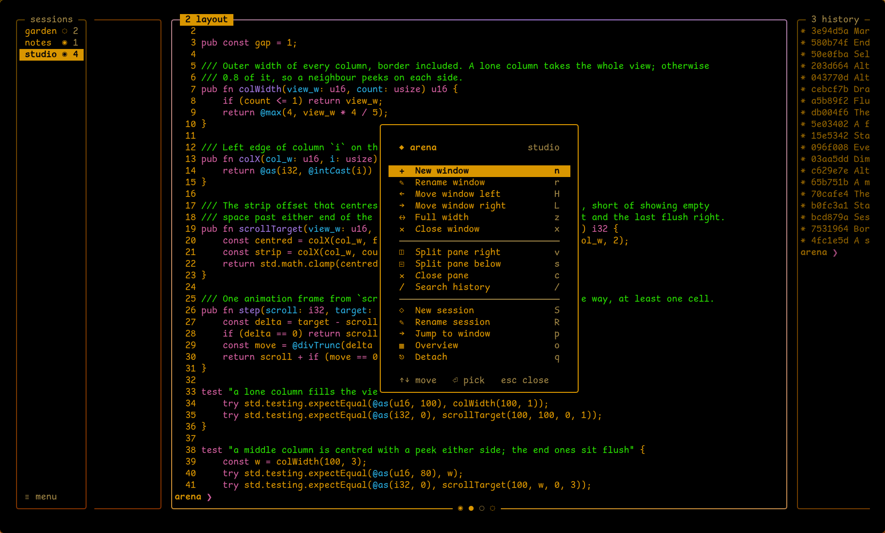

# arena

tmux sessions as a scrolling strip of columns, in your terminal.

Each tmux window is a column. The focused one sits in the middle and its neighbours peek in from
the sides, the way a scrolling window manager lays out a desktop. Sessions are stacked: left and
right move between windows, up and down between sessions.


arena is a tmux client, not a replacement for it. Your sessions live in the tmux server as they
always did; arena draws them and leaves them running when it quits.

## What it does

- **A strip per session.** Windows are columns with rounded borders; the focused one has a slowly
  turning gradient. The first and last columns sit flush against the edges.
- **A rail of sessions** down the left, with each one's window count.
- **Marks on windows running Claude Code**: `◌` while it works, `◉` once it is done and until you
  look, `▲` while it waits on an answer. Its hooks set the pane option `@arena_claude` to
  `working`, `done` or `waiting`.
- **Panes**, drawn where tmux has them. Click one to select it, drag the line between two to resize.
- **An overview** of every session's windows at once.
- **Jump** to any window in any session by typing part of its name.
- **A menu** for everything, for when you would rather click.
- **Mouse throughout**: click, wheel, drag to select and copy, drag a title to reorder.
- **Search** in a pane's history.


| | |
|---|---|
|  |  |

## Install

arena needs tmux and [Zig](https://ziglang.org) 0.17.1. With [mise](https://mise.jdx.dev):

```sh
git clone https://github.com/lessthanseventy/arena
cd arena
mise install
mise run build
```

The binary is `zig-out/bin/arena`. Put it on your path however you like.

## Use

```sh
arena             # the most recent session, or a new one when there is none
arena work        # the session called work, made if it is not there
arena -L socket   # a tmux server other than the default one
```

Everything is on Alt, so it stays out of the way of your shell and your window manager.

| Key | Does |
|---|---|
| `Alt+h` `Alt+l` | the window to the left, to the right |
| `Alt+j` `Alt+k` | the next session, the one before |
| `Alt+1` … `Alt+9` | that window |
| `Alt+H` `Alt+L` | move the window left, right |
| `Alt+J` `Alt+K` | move the session down, up the rail |
| `Alt+;` `Alt+'` | make the window narrower, wider; tmux keeps the width |
| `Alt+Enter` | a new window |
| `Alt+x` | close the window, after asking |
| `Alt+z` | give the session's columns the whole width, and back |
| `Alt+p` | jump to a window by name |
| `Alt+o` | the overview |
| `Alt+/` | search the pane's history |
| `Alt+m` | the menu |
| `Alt+q` | leave; the sessions keep running |

With the mouse:

- Click a column, a dot under the focused column, or a session in the rail to go there.
- In the overview, drag a window's picture onto another to take its place, in its own session or
  any other, or onto the rest of a session's row to put it at that session's end.
- Click a pane to select it; drag the line between panes to resize them: over it, the pointer
  shows which way it goes.
- Drag a column's title onto another column and its window takes that place; onto a session in
  the rail and it goes there. Click a title twice to rename; middle-click it to close.
- Drag a session up or down the rail to move it; the order is kept in the tmux server.
  Middle-click a session to close it, after asking; click `+ new` under the last for another.
- Drag in a pane to select text, which is copied when you let go. Two clicks copy a word.
  Where the program in the pane uses the mouse itself, it gets the mouse instead.
- The wheel scrolls the pane under it. Over the rail it steps through sessions; sideways it steps
  through windows.
- Right-click, or the button at the foot of the rail, opens the menu.

## Notes

- Colours come from `~/.config/ficciones/theme/palette.sh` when that file exists, and are read
  again when it changes. Without it arena uses your terminal's own colours.
- Set `ARENA_REDUCED_MOTION` to stop the border turning and the strips sliding.
- Copying goes through the terminal's clipboard escape (OSC 52), so the terminal has to allow it.
- Marks are up to two seconds behind: arena asks tmux for them on a timer.
- A program that draws kitty graphics the way it must under tmux, wrapped for passthrough and
  placed with Unicode placeholders, has its pictures in its column, when the terminal draws them.
  Nothing else wrapped for passthrough reaches the terminal.
- The menu's "Browser window" runs [terminal-browser](https://terminal-browser.sh), which draws
  that way, in a window of its own beside the one in view, on its start page; it has to be on the
  tmux server's path.
- It builds for macOS, and has not been run there.

## Working on it

```sh
mise run check   # the unit tests, then test/e2e.zsh
```

`test/e2e.zsh` runs arena inside one private tmux server, standing in for the terminal, against
sessions in another, and reads the screen. It touches neither your tmux server nor your
configuration.

arena keeps a copy of each pane's screen with
[libghostty-vt](https://github.com/ghostty-org/ghostty), the terminal engine from Ghostty, and
talks to tmux in control mode.
