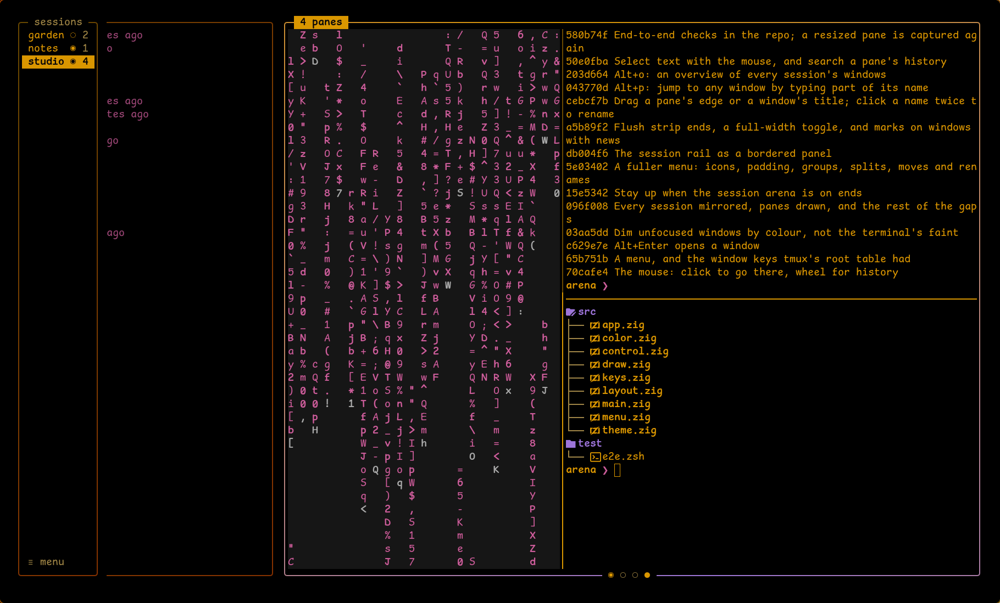
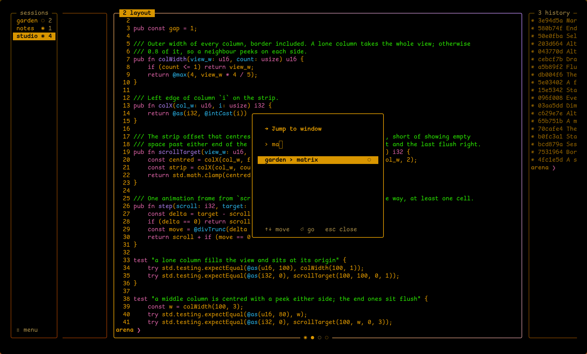

# arena

tmux sessions as a scrolling strip of columns, in your terminal.

Each tmux window is a column. The focused one sits in the middle and its neighbours peek in from
the sides, the way a scrolling window manager lays out a desktop. Sessions are stacked: left and
right move between windows, up and down between sessions.


arena is a tmux client, not a replacement for it. Your sessions live in the tmux server as they
always did; arena draws them and leaves them running when it quits.

## What it does

- **A strip per session.** Windows are columns with rounded borders; the focused one has a slowly
  turning gradient. The first and last columns sit flush against the edges.
- **Report this.** `Alt+!` (or Report this in the menu) asks one line, "what's wrong?", and files a
  babylon ticket in arena with it: what the pointer is over, what is picked, the view, the
  window's size, the rail's width and arena's commit. The screen as text (with the styles around
  the pointer) and the last input are saved beside it in `$XDG_STATE_HOME/arena/reports/`, so a
  bug arrives reproducible. What is typed into a pane is counted there, never kept.
- **A rail of sessions** down the left, with each one's window count. `w` in normal mode or a click on its
  top narrows it to two letters a session and a mark and time a Claude; resting the pointer on
  the narrow rail draws it wide over the strip until the pointer leaves.
- **Marks on windows running Claude Code**: `◐` turning while it works, or while a subagent it
  started works, `◔` between turns while only a shell it started runs, `◉` once it is done and
  until you look, `▲` while it waits on an answer; a session's mark has a count when several of
  its Claudes share it, `▲2`, and with no Claude to mark it has tmux's own `!` for a window that
  rang its bell or `#` for one with output where `monitor-activity` is on. One out of view that comes to wait or is done
  is a desktop notification too, through `notify-send` where there is one. arena's Claude Code plugin sets the pane option `@arena_claude` to
  `working`, `background`, `done`, `waiting` or `stalled` (its turn ended on an API error) ([Install](#install)).
- **Its Claudes listed** under the sessions in the rail, each session's together: the session whose
  Claude most wants looking at first, and in it the most pressing, or, a click on their rule
  away, the one heard from last first; the session in view has its name in amber there, and the
  Claude in view its title. A Claude has its mark, what its conversation is about
  and how long it has been in its state; under that what it is doing, waits for or last said,
  with how long its last turn took, or `quiet` and how long when it has worked ten minutes with
  nothing heard from it; under that its branch (or `no repo`, `detached` and the commit), its
  review and its context: the share of its budget, drawn to be seen past 80%, where your status
  line sets the pane option `@arena_claude_ctx` to it (hooks are not told the window's size),
  else its tokens; and under that a row for each subagent it has in the background, then its
  shells there. A subagent's row is lit while its Claude shows that subagent, where the Claude
  is in the session in view. What a conversation is about is the name you gave it with `/rename`, else a topic Haiku
  is asked for every fifth prompt (one small `claude -p` call, in the background), else the title
  Claude Code gave it at its start. The hook needs `jq` for all of that text.
- **A mark for code review** beside it: `✗` when changes are asked for, `»` while queued to merge,
  `✓` once approved, `◆` once landed. Set the pane option `@arena_review` to `changes`, `queued`,
  `reviewed` or `landed`; a session shows the one that most wants looking at.
- **Panes**, drawn where tmux has them. Click one to select it, drag the line between two to resize.
- **An overview** of every session's windows at once.
- **The board**: the tickets every Claude on the machine shares, from [babylon](https://github.com/lessthanseventy/babylon),
  in place of the strip, a column for each of todo, doing, review and done. With every repo shown, done is a narrow strip headed `recent`, each lane's last few closed a dim `✓` row, and its `reopen` on the strip's foot for the picked one. A card has its number and title, whole on two lines, and under them its repo, the window of the Claude
  holding it with that Claude's mark and how long it has held it (in review, the pipeline's stage in its place), what it waits on, where it is on babylon's way to main (queued, or `held` while queued behind a question of its own, verifying, reviewing,
  landing, `✗ sent back`, `◆ landed`) and `? asks` when its Claude waits on a decision from you:
  `a` shows the question and its options, and an option's number answers it, typed into that
  Claude by babylon. `G` on a free todo card lists the running Claudes, and one's number, or
  `j`, `k` and Enter, gives it the card: babylon types the claim into that Claude as your word,
  and says why when it will not (that Claude is mid-turn, or waits on you). One that waits is dimmed, at the foot of its column. Its first row has the repos as tabs, the one shown lit: a click on one narrows the board to it,
  and `r` goes to the next, then every one again; the gate is a button beside them while babylon
  runs one, and `?` shows every key. `o` goes to the orchestrator, started first when it is not
  running; the board's row atop the rail says after its name whether it runs, and `orch off`
  while babylon does not keep it running. `A`, or the `auto` button beside the tabs, turns babylon's
  auto mode on and off: while it is on, babylon starts a Claude on each free todo card, up to its
  cap of Claudes working, and the button, the board's header and its row atop the rail say `auto 1/2`, one
  working of a cap of two. A `+` on the to-do column files a ticket, and the picked card
  shows what can be done to it as chips under it, each run by a click. Enter, or a second click,
  on a card goes to the Claude holding it. `n` files a ticket and `e` edits the picked one, its
  title, repo and body in `$EDITOR` in a window of their own; `p` raises its priority, from high
  back to low; `>` closes a ticket still to do and `<` opens a closed one again; `J` and `K` move it
  down or up its column among its repo's cards; one with no repo, or a repo whose name is not
  plain, stays where it is. Space shows the picked card's whole ticket over the board: its body, links,
  stage and the note on it, and the last of its gate's log. The board's row atop the rail counts what is to do and being
  done, and a click there goes home; it is there while babylon keeps its file.
- **Home**: the board with the orchestrator's column pinned on its right (60 cells, less on a
  narrow screen), the column with the keys. `arena` with no session named opens it, and `b` in
  normal mode, a click on the board's row atop the rail and `arena inbox` go there. The column's
  head on its top edge says the orchestrator's state (`working 12s`, `▲ waits on you`, `idle`,
  `◌ restarting`, `off`) and its context's share; while it is off the column says
  `orchestrator off · ⏎ start it`, and Enter there runs `babylon orchestrator`. When the
  orchestrator's session ends, as babylon restarts it, home stays open in the session you were
  in, and the column comes back on the new one with the keys where you left them. While the
  orchestrator runs, its window shows beside the board, arena in its session to have it live:
  a column like any other, with the board the one before it. Alt+l, or a click on it, focuses it,
  and it is lit: what is typed, the wheel and the mouse are then its own. Alt+h, or a click on the
  board, goes back to the board. `` ` `` folds it away, and the
  board opens so until it is unfolded. Closing the board goes back to the session you were in.
  Atop the column, above the orchestrator's pane, is the feed: what is your move as babylon's
  `needs_you` words it, each with its actions, then what is landing in queue order, what is
  being built, and how many landed today. It is read from babylon's file, so it stays while the
  orchestrator is off or restarting.
- **Jump** to any window in any session by typing part of its name.
- **A menu** for everything, for when you would rather click.
- **Mouse throughout**: click, wheel, drag to select and copy (shift-drag over a program that takes
  the mouse), middle click to paste what was last selected, drag a title to reorder.
- **Search** in a pane's history.




| | |
|---|---|
|  |  |

## Install

arena needs tmux and [Zig](https://ziglang.org) 0.17.1. With [mise](https://mise.jdx.dev):

```sh
git clone https://github.com/lessthanseventy/arena
cd arena
mise install
mise run build
```

The binary is `zig-out/bin/arena`. Put it on your path however you like.

The marks on windows running Claude Code come from its hooks, which the checkout is a plugin of:
`claude --plugin-dir /path/to/arena`, or the path in `CLAUDE_CODE_PLUGIN_DIRS` (a `:` list) for
every session. The plugin also gives each session [babylon](https://github.com/lessthanseventy/babylon)'s tickets, shared
by every Claude on the machine, over MCP.

## Use

```sh
arena             # home: the board and the orchestrator's column; with no board, the most recent session
arena work        # the session called work, made if it is not there
arena -L socket   # a tmux server other than the default one
arena board 240   # the board on ticket 240, in the arena that is running
arena show %290   # pane 290 in front: its session and window, picked in the rail
arena show '#324' # the pane of the Claude holding ticket 324
arena inbox       # home, with what needs you atop the orchestrator's column
```

`board`, `show` and `inbox` are the only supported way in from outside arena: the shell's popups,
babylon's notices and other Claudes all call them, so each place sends the human somewhere
through arena, which follows, not behind its back through tmux's `select-window`, which it
does not. With no arena running, `show` and `inbox` exit 3 and leave opening one to the caller.

`arena board <id>` has the running arena open its board with that
ticket picked, the ticket's question over it when it waits on one, and comes back at once. A
ticket the board shows nowhere, a done one older than its repo's last three, has its whole
detail over the board in the pick's place. With
no arena running it starts one, so opened. It reaches arena through tmux, and only arena: each
arena names its client in the server's `@arena_clients`, so another control-mode client there,
as iTerm's, is told nothing. `-L` names the server there too.

There are two modes, and a single letter is never arena's in the first. In insert, the default,
every key goes to the shown pane, apart from a few Alt chords. `Ctrl+Space` makes it normal,
where no key is typed into a pane, `NORMAL` shows at the bottom-left and the row under the strip
says the keys; `i`, `Esc` or `Ctrl+Space` is insert again. A click on a pane is insert, and one
on the rail is normal. With the board open, `Ctrl+Space` focuses the orchestrator's column, as
`Alt+l`.

Alt+j, Alt+m, Alt+o, Alt+p and Alt+w are not arena's, so they reach Claude Code: Alt+o toggles
its fast mode and Alt+p opens its model picker. Their arena uses are the normal-mode keys below.

In normal mode:

| Key | Does |
|---|---|
| `j` `k` | the pick down or up the rail; `⏎` goes to it, `space` opens it |
| `]` `[` | the next or previous Claude that waits or is done |
| `h` `l` | the window to the left, to the right |
| `1` … `9` | that window |
| `H` `L` | move the window left, right |
| `J` `K` | move the session down, up the rail |
| `;` `'` | make the window narrower, wider; tmux keeps the width |
| `c` | a new window |
| `x` | close the window, after asking |
| `z` | give the session's columns the whole width, and back |
| `/` | find: a window by name, a Claude by its branch, a ticket by its number or title; `⏎` goes |
| `o` | the overview |
| `b` | the board |
| `n` | the needs-you inbox |
| `g` | the gate's modal, for the run in progress |
| `w` | the rail narrow, and wide again |
| `m` | the menu |
| `?` | these keys |
| `Q` | leave; the sessions keep running |

The chords that stay on Alt, in every mode: `Alt+h` `Alt+l`, `Alt+k`, `Alt+1` … `Alt+9`,
`Alt+H` `Alt+L` `Alt+J` `Alt+K`, `Alt+;` `Alt+'`, `Alt+Enter`, `Alt+x`, `Alt+z`, `Alt+b`,
`Alt+n` `Alt+N` (the next Claude waiting or done, the one before), `Alt+/` (search the pane's
history), `Alt+q` and `Alt+!`.

With the mouse:

- Click a column, a dot under the strip, or a session in the rail to go there. With the pointer
  on the row of dots it has each window's number and name instead, to click, and the wheel there
  steps through the windows.
- Click a Claude in the rail to go to its window, the rule over them to change their order, the
  rail's top to narrow or widen it. Click a subagent's row under it and that Claude shows the
  subagent too: arena types Down into it until its list of agents has the pointer, then to the
  subagent's row, and Enter.
- In the overview, drag a window's picture onto another to take its place, in its own session or
  any other, or onto the rest of a session's row to put it at that session's end.
- Click a pane to select it; drag the line between panes to resize them: over it, the pointer
  shows which way it goes.
- Drag a column's title onto another column and its window takes that place; onto a session in
  the rail and it goes there. Click a title twice to rename; middle-click it to close.
- Drag a session up or down the rail to move it; the order is kept in the tmux server.
  Middle-click a session to close it, after asking; click `+ new` under the last for another.
- Drag in a pane to select text, which is copied when you let go. Two clicks copy a word.
  Where the program in the pane uses the mouse itself, it gets the mouse instead.
- The wheel scrolls the pane under it. Over the rail it steps through sessions; sideways it steps
  through windows.
- Right-click, or the button at the foot of the rail, opens the menu.

## Notes

- Colours come from `~/.config/ficciones/theme/palette.sh` when that file exists, and are read
  again when it changes. Without it arena uses your terminal's own colours.
- Set `ARENA_REDUCED_MOTION` to stop the border turning and the strips sliding.
- Copying goes through the terminal's clipboard escape (OSC 52), so the terminal has to allow it.
- Marks are up to two seconds behind: arena asks tmux for them on a timer.
- A program that draws kitty graphics the way it must under tmux, wrapped for passthrough and
  placed with Unicode placeholders, has its pictures in its column, when the terminal draws them.
  Nothing else wrapped for passthrough reaches the terminal.
- The menu's "Browser window" runs [terminal-browser](https://terminal-browser.sh), which draws
  that way, in a window of its own beside the one in view, on its start page; it has to be on the
  tmux server's path.
- It builds for macOS, and has not been run there.

## Working on it

```sh
mise run check   # the unit tests, then test/e2e.zsh
```

`test/e2e.zsh` runs arena inside one private tmux server, standing in for the terminal, against
sessions in another, and reads the screen. It touches neither your tmux server nor your
configuration.

arena keeps a copy of each pane's screen with
[libghostty-vt](https://github.com/ghostty-org/ghostty), the terminal engine from Ghostty, and
talks to tmux in control mode.
