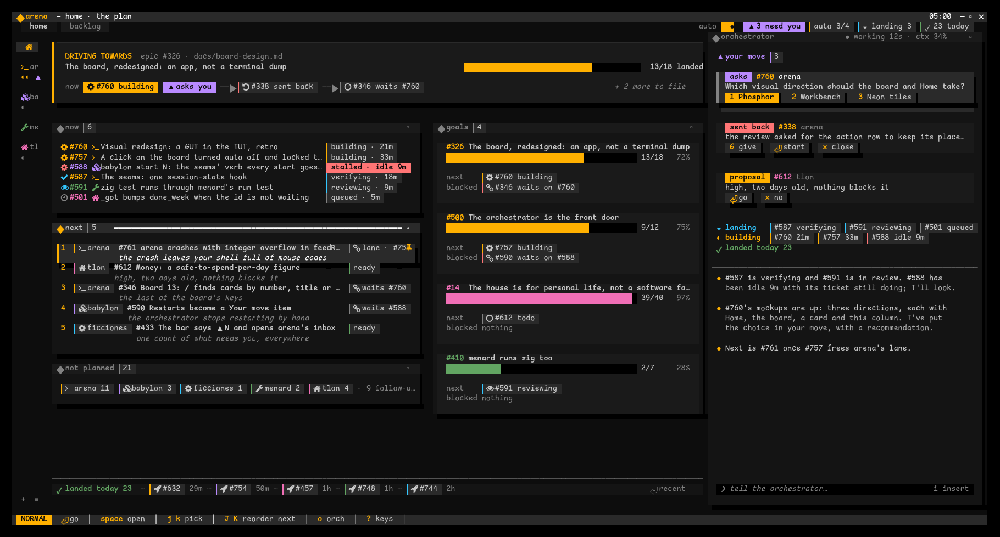
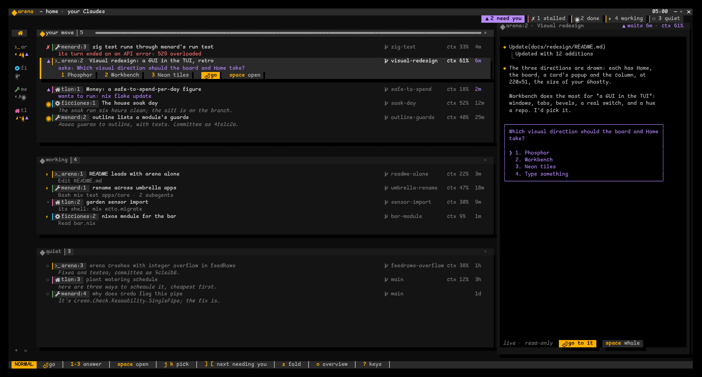

# arena alone

This design is for #963. It follows [the principles](principles.md). Nothing in it is approved or
built yet. The build is the tickets at the end, which get filed once the human gives the go.

The human, 2026-11-25: "I think we also need to consider the use case of like not using the
board/planning/babylon tools at all and just have arena as a herdrish multiplexer of sorts".

## What is already there

Most of "arena alone" exists. What is missing is a home that does not assume a board.

- **arena reads babylon through one file.** `boardPath` (src/main.zig:87) looks for
  `babylon/board.json` under `$XDG_RUNTIME_DIR`, then `$XDG_STATE_HOME`, then `~/.local/state`.
  `BoardFile.check` reads it every second (`theme_check_ms`, main.zig:19). A missing or unreadable
  file gives `app.board == null`, and `setBoard` closes the board view (app.zig:3570).
- **Every Claude's state is arena's own.** The rail's marks (`◐` working, `◔` only its shell runs,
  `▲` waiting, `✗` stalled, `◉` done and not looked at) and its words (what it is about, what it is
  doing or last said, its branch and context) are pane options set by arena's `claude-state.sh`
  hook. arena reads them with one `list-panes` (app.zig:70). Babylon is not involved.
- **"Looked at" is arena's too.** `see` (app.zig:1944) clears `◉` when the window is the one in
  front.
- **Answering a question box without babylon exists.** A Claude's own question box can be
  answered by sending its option's keys into the pane (app.zig:1407).
- **Without a board today,** arena opens the most recent session's strip. `b` and `n` do nothing,
  because `goHome` returns at once (app.zig:4510). The rail's top row is left blank (draw.zig:427).
- **After Portable 4 (#962)** arena's plugin is just `claude-state.sh` and `tmux-guard.sh`.

## How arena knows

**No board.json means alone. No setting is needed.** The file is already read every second, so:

- **Babylon starting later** gives a board on the next read. The rail's top row gains its board
  counts, and Plan becomes home. If the human is on the alone home at that moment, it stays until
  they leave it. Plan is what `b` opens from then on. Nothing redraws under them.
- **Babylon going away** gives no board. Today that drops the human out of the board view to a
  strip. Instead, home becomes the alone home in place, because what it showed is gone.

**Open:** a board.json left behind by a babylon that has stopped reads as babylon running. The
file is only rewritten on a change, so its age does not say whether babylon is alive. Build
ticket 2 checks what babylon does to the file on stop. If it leaves it, a babylon ticket asks it
to remove the file.

## Home, alone

Today's Plan, then the alone home in the same frame (220×51 cells, Workbench, drawn by
`arena-mock`):

| today, with babylon | alone |
| --- | --- |
|  |  |

The two homes have the same shape: windows on the left and a 60-cell column on the right. A
Claude is the unit, where on Plan it is a ticket.

### Piece by piece

1. **The head.** `◆ arena — home · your Claudes`, then a count for each state: `▲ 2 need you` in
   the "you" colour and filled, `✗ 1 stalled`, `◉ 2 done`, `◐ 4 working`, `○ 3 quiet`. There is no
   auto, landing or today, because those are babylon's.
2. **Your move.** Every Claude that needs the human: `✗` stalled, then `▲` waiting, then `◉` done
   and not looked at, oldest first within each. That is the rail's urgency order (`urgency`,
   app.zig:895), so the rail and home always agree.
   - Each row has the mark and `session:window` in its repo's colour, then what it is about. On the
     right are its branch, context and how long it has been like this. Its second line is what it
     asks, what it wants to run, the error it stopped on, or its last words.
   - The picked row gets a third line of buttons. A question box's options are `1`–`9`, answered
     by sending the keys into the pane, which already exists. Then `⏎ go` and `space open`.
   - This is the one window allowed to grow ([principle 10](principles.md)). When it is empty, it
     is one line: `nothing needs you`.
3. **Working.** `◐` and `◔` Claudes, the one heard from last on top. The second line says what it
   is doing, with its subagents and shells.
4. **Quiet.** Claudes that are done and looked at, or idle, shown dim with their last words. A
   Claude leaves the list when its pane closes.
5. **The column: the picked Claude's pane, live and read-only.** It sits where the orchestrator
   column is on Plan. It is the peek from [principle 4](principles.md) held in a slot of its own.
   Its head shows `session:window · title`, the state and the context. `⏎` goes there, and `space`
   opens it whole as a modal over home.

### Keys

| key | does |
| --- | --- |
| `j` `k` | pick down or up, across the three windows |
| `⏎` | go to the picked Claude's pane |
| `space` | its pane whole, as a modal |
| `1`–`9` | answer the picked Claude's question box with that option |
| `]` `[` | the next or previous Claude in Your move, as in the strip |
| `z` | fold the window the pick is in, as on Plan |
| `/` | find, as everywhere |
| `o` | the overview of every window |
| `x` | close the picked Claude's window, after asking |
| `b` `esc` | back to where the human was |
| `?` | every key |

`◉` clears when the human goes to a Claude (`⏎`) or opens it (`space`), as `see` does today.
Resting the pick on it, with its pane in the column, does not clear it, because looking moves
nothing ([principle 5](principles.md)).

At half the screen, home shows the list or the column, swapped with `p` and `o` as on Plan (#527).

### The rail

The rail's top row reads `◆ home ▲ 2` in both modes, with the count of Your move when alone and
babylon's counts with it. Today the row is blank without a board. If it came and went with
babylon, every session under it would move a row ([principle 10](principles.md)).

## What disappears

Without a board, none of these are drawn. Nothing is greyed out or left as a dead key.

| with babylon | alone |
| --- | --- |
| Plan, its windows, `+ goal`, `d` drive | the alone home |
| the board, `B`, its tabs | gone (it is going anyway, #907) |
| the orchestrator column, `o` from home, Alt+l focus, `orch` on the rail | the picked Claude's pane. `o` is the overview |
| the feed: next, landing, building, today | Your move, from the marks |
| the head's auto, landing, `✓ today`; `A` and its modal | gone |
| `g`, the gate's modal | gone |
| `n` the inbox | home, with the pick on Your move's first |
| `arena inbox` | the same: home, Your move first |
| `arena board N` | exits 2 with `arena: no board` (today it does nothing) |
| the menu's Board entry | gone |
| Report this (`Alt+!`) filing a babylon ticket | saves the report in `$XDG_STATE_HOME/arena/reports/` as it already does, and says where |
| `?` lines about the gate, auto and the orchestrator | gone |
| the word "babylon" anywhere on screen | none. Babylon's refusals cannot happen without it |
| the plugin's babylon hooks and MCP server | gone with #962 |

What stays the same: the strip, the rail and its marks, the overview, jump, the menu, search,
the mouse, notifications, `arena show`, and every strip key.

## Installing arena alone

- **The arena binary** (#957 makes it a download), tmux, and **arena's plugin**: two hooks after
  #962. `jq` makes the marks' words fuller, as today.
- **The README leads with this.** Its first screen is the strip and the alone home. "With babylon"
  is a section after Install: what babylon adds (Plan, the board, the orchestrator, auto, the
  gate) and how to install it.

## herdr and the others

These are what a herdr-style tool does, read from their READMEs and docs:
[herdr](https://github.com/ogulcancelik/herdr),
[claude-squad](https://github.com/smtg-ai/claude-squad),
[ccmanager](https://github.com/kbwo/ccmanager), [uzi](https://github.com/devflowinc/uzi) and
[vibe-kanban](https://github.com/BloopAI/vibe-kanban).

| what they do | arena alone |
| --- | --- |
| a list of agents with a state each: idle, working, blocked, done | **have it.** The hook sets the state, so it is exact. herdr reads the screen |
| a toast or sound when an agent out of view changes state | **have it,** for `▲` and `◉` only, through `notify-send` ([principle 8](principles.md)) |
| a state rolled up per workspace | **have it,** as the rail's session marks with counts (`▲2`) |
| a preview of an agent's pane | **have it** in the column |
| kill an agent | **have it:** `x` |
| `n`: a new agent in a new window, with its first prompt | **take it,** small: `+` on home asks for a directory (the repos of the Claudes it knows, or typed), then opens a window running `claude` in that repo's session, made if missing. The rail's `+ new` makes only a bare session today |
| `uzi ls`, herdr's socket API: agents and scripts can read the list | **take it:** `arena claudes [--json]` prints the list home shows ([principle 7](principles.md)) |
| a git worktree per agent | **leave it.** `wt` and Claude Code's own worktrees do this, and it is not a multiplexer's job |
| a diff view per agent | **leave it** for now. The pane shows what the Claude says it did |
| auto-answering an agent's prompts (`--autoyes`, `uzi auto`) | **leave it.** It takes decisions away from the human |
| restoring sessions after a reboot | **leave it.** tmux-resurrect and `claude --resume` do it |
| state read from the screen, for agents without hooks | **leave it.** arena is for Claude Code, whose hooks are exact |

## Open

- **A stale board.json** (above). Build ticket 2 settles it.
- **The alone home with babylon there.** Recommendation: not now. With babylon, Your move is
  babylon's, and the rail already lists every Claude. If the human wants it, it can be one more
  key later.

## The build

All arena, and each a specified Sonnet ticket. They are filed on the human's go.

1. **The alone home.** With no board, `goHome` draws the head, the three windows and the picked
   Claude's pane in the column. It adds the keys above, `◆ home` atop the rail in both modes, and
   half-screen `p`/`o`. Free.
2. **Babylon coming and going.** Plan and the alone home swap without a restart, as above. It checks
   what babylon does to board.json on stop and files a babylon ticket if needed. An e2e test covers
   both ways. After 1.
3. **Nothing of babylon's shows alone.** `B`, `g`, `A` and `n`, `?` lines, the menu's Board,
   Report this, `arena board N` and `arena inbox`, from the table. After 1.
4. **`+` a new Claude** from home. After 1.
5. **`arena claudes [--json]`.** Free.
6. **The README leads with arena alone**, and a "With babylon" section follows. Screenshots are
   taken again. After 3, #957 and #962.

## How the mock was drawn

`arena-mock` has an `alone` screen. Its Claudes are a fixture in `src/mock.zig`, since there is no
board to draw them from.

```sh
zig build
zig-out/bin/arena-mock workbench alone docs/redesign/board.json ~/.config/ficciones/theme/palette.sh 220x51 alone.html
```

The page is then screenshotted at 1820×979, as `docs/redesign/shoot.zsh` does. Each cell keeps its
width, `min-width:0`, and a glyph the font draws wider than its cell (`◉`, `▲`, `◆`) is drawn over
the next cell, not under it. That is how Ghostty draws them. Before this, such a glyph pushed the
rest of its row to the right.
