# Redesign: a GUI in the TUI

Three visual directions for Home (the plan), the board, a card's popup and the orchestrator's
column, for #760. Held to [the principles](../principles.md). Nothing here is built yet.

The human, 2026-11-24: "i want it to feel like a modern app, but retro style and in the terminal…
we've got a whole palette and we're just using it to put a bunch of text on the screen but i want
it to feel like it's a gui in the tui". On Home: "this could use the same kinda spiffing up as
we're putting towards the board."

## How these were made

Each screenshot is a frame drawn by `arena-mock` (`src/mock.zig`). It parses
[board.json](board.json) with arena's own `board.zig`. The fixture has five repos, four epics, an
ask, a send-back, a stalled Claude and a queue. The colours come from the human's palette
(`~/.config/ficciones/theme/palette.sh`). The frame is 220×51 cells, the size of the human's tiled
Ghostty on DP-3 (1820×979 px, Comic Shanns 11pt, 22px padding), and Ghostty's `minimum-contrast
= 4.5` is applied to text as Ghostty applies it. `zsh docs/redesign/shoot.zsh` draws each frame as
a page of cells and screenshots it in a headless browser, so nothing opens on the desktop. Block
elements are drawn as shapes that fill the cell, as Ghostty draws them.

arena's own drawing is untouched: `arena-mock` is a separate program.

What every direction shares, decided by the ticket and the orchestrator's brief:

- **Filled surfaces, not outlines.** Columns are panels, cards are tiles, and the pick is raised.
- **A card is its title, bold, on at most two rows, then a row of pills:** repo (with a Nerd Font
  glyph), the state or what it waits on, the model, and an age. Priority is a dot in the corner.
- **Buttons are pills, and only the primary one is filled.** They show only on the picked thing.
- **Home has one focal point:** the goal we are driving towards, with a real progress bar and its
  steps in flight as a chain. Goals are cards with a bar, their next step and what blocks them.
  Next is a numbered queue with chips. Landed today is a strip.
- **The board** has epics as slim bars along its top, count badges on its column headers, repo
  groups inside each column, and recent as a timeline strip of the last five.
- **The orchestrator's column** keeps Your move on top, each item a tile with its buttons, then
  landing and building as chips, then its Claude and the prompt well.
- **One colour means "you":** asks and `▲ N need you` are always in it, and nothing else is.

## The three

| | Home | Board | Popup | Orchestrator |
| --- | --- | --- | --- | --- |
| [Phosphor](phosphor.md) | 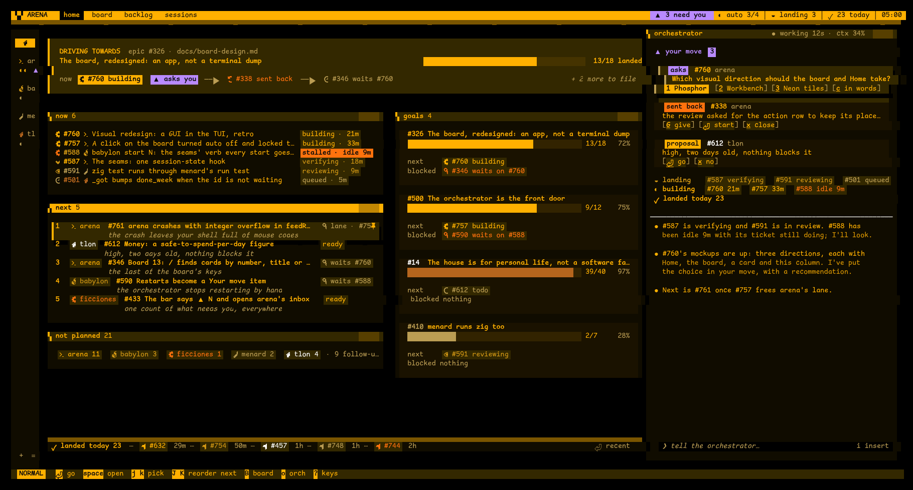 | 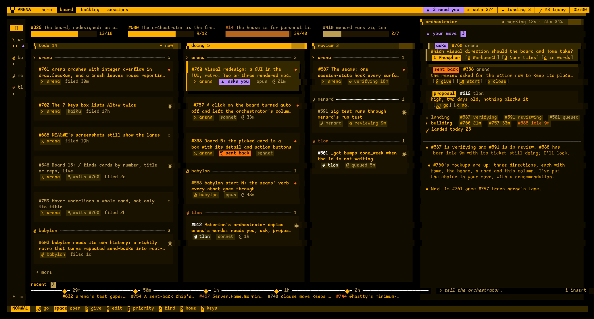 | 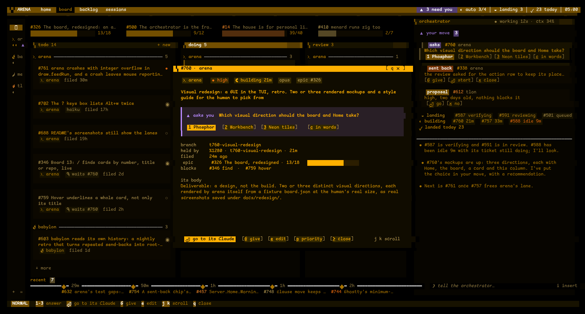 | 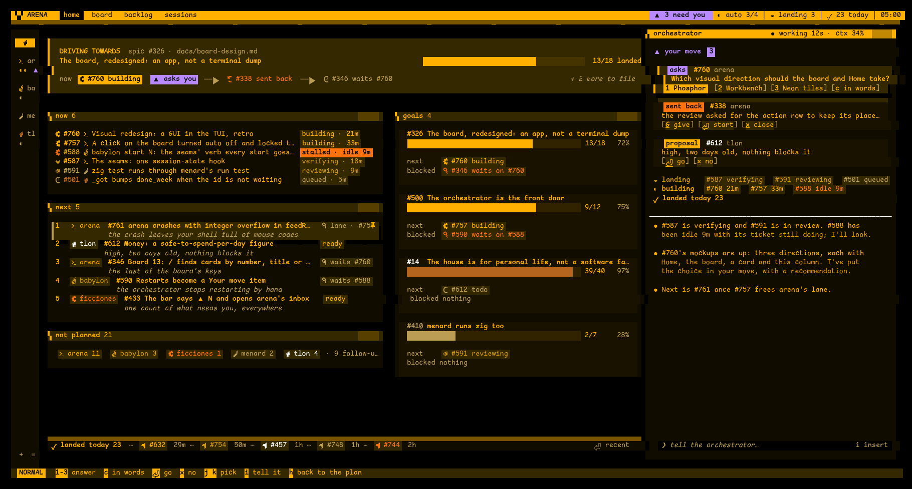 |
| [Workbench](workbench.md) | 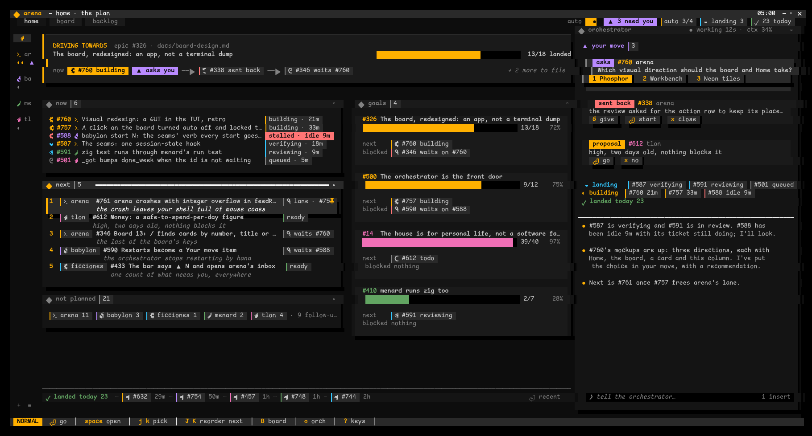 | 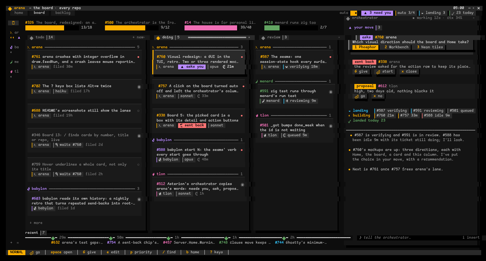 | 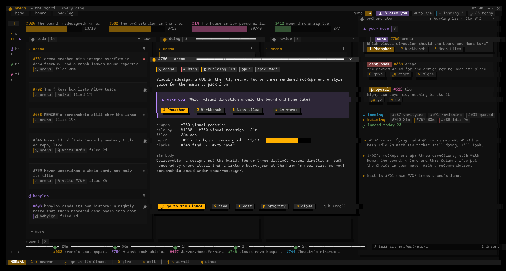 | 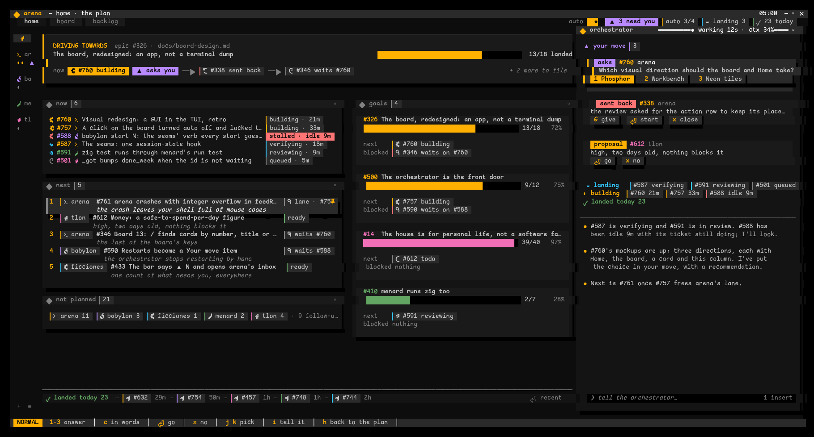 |
| [Neon tiles](neon.md) | 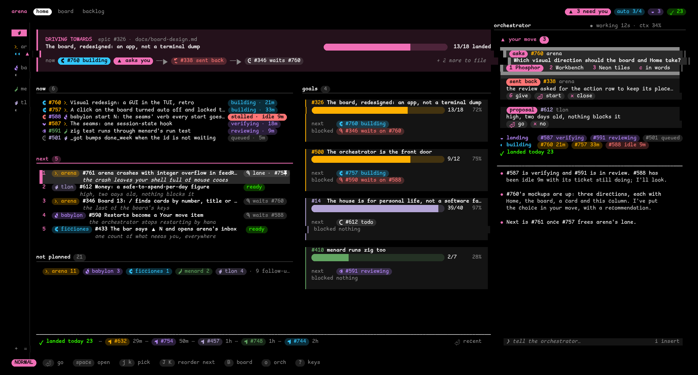 | 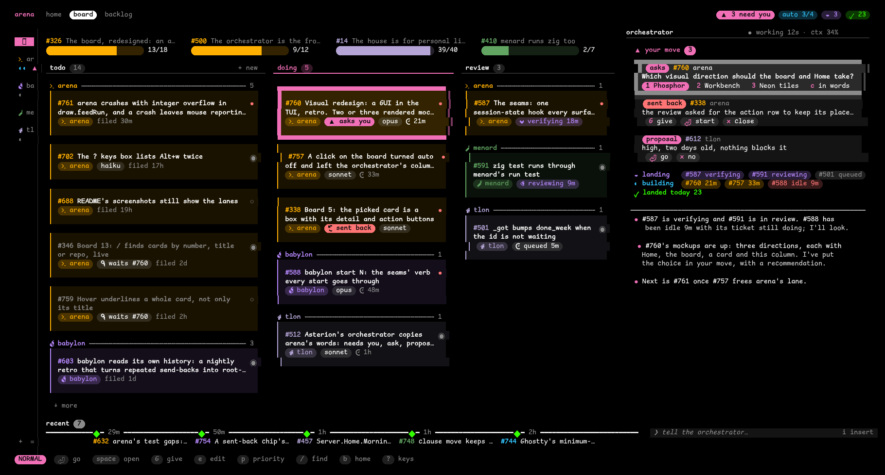 | 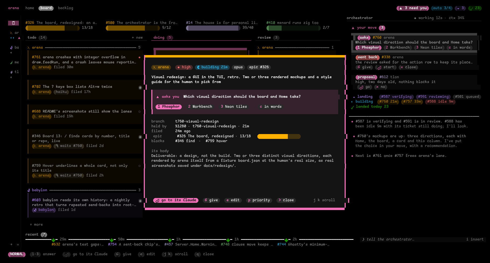 | 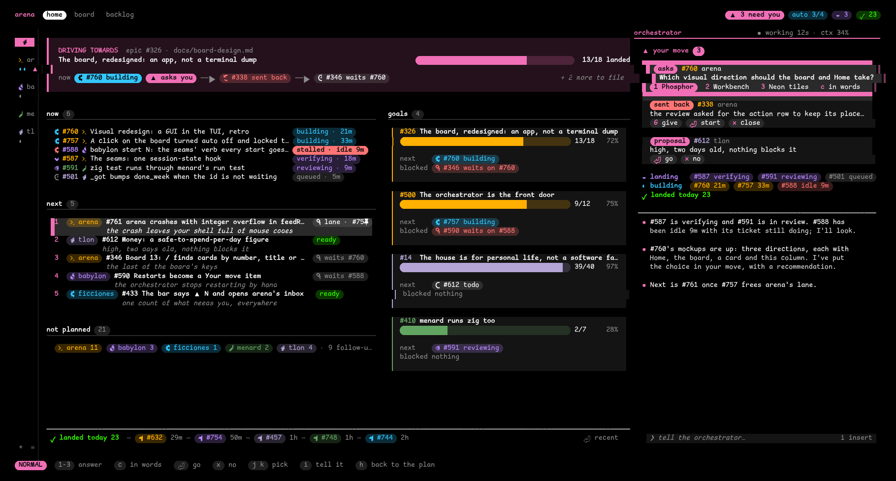 |

- **Phosphor:** an amber CRT application. It is monochrome amber in four tints, with a solid
  menu bar, inverted tabs and shade-block bars. Violet appears only for what needs you. It is the
  most retro of the three, and it uses the least of the palette.
- **Workbench:** a desktop GUI from 1990, on today's palette. Every panel is a window, with a
  title bar, a close box and a hard half-block shadow. Tabs join the window under them, buttons
  are bevelled, auto is a real switch, and each repo has a hue of its own. It is the most "GUI in
  the TUI" of the three.
- **Neon tiles:** a modern flat app, such as Linear, in a terminal. It has no chrome. Its pills
  have rounded caps, and its tiles are tinted with their repo's colour. The pick sits in a
  half-block ring in pink. It is the most modern of the three, and the least retro.

## Recommendation

**Workbench.** It does the most for what the human asked. It reads as an application, with
windows, tabs, bevels, a switch and depth. It uses the whole palette: a hue a repo and a hue a
state, and violet only for "you". Its look is old desktop software, not a dashboard. Its shapes
are plain blocks and lines that every terminal draws, and its surfaces are grey, so the colours
stand out against them.

Phosphor is the purest retro, but it is one hue: repos are told apart by glyph alone, and the
palette stays unused. Neon is the most modern, but it is the least "retro". Its tinted tiles also
turn the amber repo's cards brown.

The pieces can be mixed. Neon's rounded pills could be the chips in Workbench, or Phosphor's
menu bar its header.
